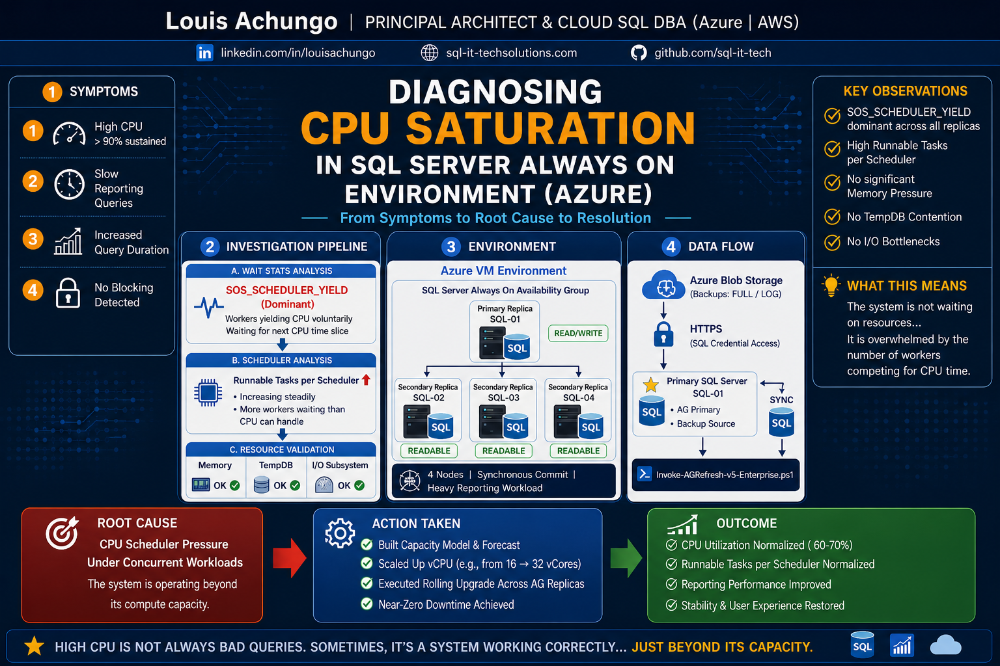

# SQL Server CPU Saturation RCA

Diagnosing Scheduler Pressure in Always On & High-Concurrency Environments


---

> [!WARNING]
> This repository documents a specific production case and provides diagnostic examples for controlled evaluation. Review permissions, SQL Server compatibility, and workload impact before running queries. Capacity changes and Availability Group operations require environment-specific planning, testing, and recovery procedures.

## 🏢 Case Study: Enterprise SQL Server Performance Engineering

This project is based on a real-world production scenario involving:

- 4-node SQL Server Always On Availability Group
- Azure VM deployment
- High-concurrency reporting workloads

The objective was to identify the root cause of sustained CPU saturation and implement a scalable solution without downtime.

---

## Business Impact

- Identified root cause of sustained CPU saturation
- Avoided unnecessary infrastructure changes
- Enabled evidence-based capacity planning
- Improved reporting workload performance
- Preserved Always On availability throughout remediation

## 🧠 Philosophy

> Don’t guess. Measure → Correlate → Prove → Act.

---

## 📊 Architecture Overview



---

## ⚡ Why This Matters

High CPU requires correlated evidence to distinguish inefficient execution from capacity pressure.

This playbook demonstrates how to:

- Avoid guesswork
- Use SQL Server internals to identify bottlenecks
- Apply evidence-based scaling decisions

This is the difference between:

❌ Reactive troubleshooting  
✅ Performance engineering  

---

## 🔍 Problem Statement

High CPU in SQL Server is often misdiagnosed as:

- Bad queries  
- Missing indexes  
- General performance issues  

One condition to investigate under concurrent workloads is:

> 🔥 CPU Scheduler Pressure under concurrent workloads

---

## ⚠️ Key Signals

| Signal | Interpretation |
|---|---|
| SOS_SCHEDULER_YIELD | Workers voluntarily yielding the scheduler; not proof of CPU saturation by itself |
| Persistently elevated runnable tasks | Tasks waiting for scheduler CPU time; correlate with CPU utilization over the same interval |
| Sustained high SQL Server CPU | Supports CPU pressure when correlated with runnable queues and workload evidence |
| Limited competing resource waits | Helps narrow the investigation but does not independently establish root cause |

---

## 🧪 Technical Analysis

### 1. Wait Stats Analysis

```sql
SELECT TOP 10 wait_type, wait_time_ms
FROM sys.dm_os_wait_stats
ORDER BY wait_time_ms DESC;
```
These counters are cumulative since instance startup or the last wait-statistics reset. Capture interval deltas during the incident; lifetime totals alone do not describe the incident window.

### 2. Scheduler Pressure

```sql
SELECT scheduler_id, runnable_tasks_count
FROM sys.dm_os_schedulers
WHERE status = 'VISIBLE ONLINE';
```

### 3. CPU Utilization

Extract recent scheduler-monitor CPU samples from the ring-buffer XML:

```sql
;WITH CpuSamples AS
(
    SELECT
        [timestamp],
        TRY_CONVERT(xml, record) AS RecordXml
    FROM sys.dm_os_ring_buffers
    WHERE ring_buffer_type = N'RING_BUFFER_SCHEDULER_MONITOR'
)
SELECT TOP (30)
    [timestamp] AS SampleTimestampMs,
    RecordXml.value(
        '(/Record/SchedulerMonitorEvent/SystemHealth/ProcessUtilization)[1]',
        'int'
    ) AS SQLProcessUtilization,
    RecordXml.value(
        '(/Record/SchedulerMonitorEvent/SystemHealth/SystemIdle)[1]',
        'int'
    ) AS SystemIdle
FROM CpuSamples
WHERE RecordXml.exist(
    '/Record/SchedulerMonitorEvent/SystemHealth'
) = 1
ORDER BY [timestamp] DESC;
```

Use these samples as supporting evidence and corroborate with operating-system or Azure VM CPU monitoring.

### 4. Rule Out Other Bottlenecks

- Memory Grants Pending  
- TempDB contention  
- I/O latency  

---

## 🔥 Root Cause Identification

The investigation identified CPU capacity pressure under concurrent reporting workloads, supported by:

- Sustained high SQL Server CPU utilization
- Persistently elevated runnable queues
- Correlated workload and wait-statistics evidence
- Evaluation of competing bottlenecks

Scheduler pressure describes the observed condition. Query efficiency, concurrency, parallelism, and available CPU capacity must be evaluated to explain why it occurred.

---

## 🚀 Engineering Solution

- Built capacity model  
- Scaled vCPU resources  
- Executed coordinated VM resizing across AG replicas
- Validated post-change metrics  

---

## 📈 Outcome & Impact

- CPU stabilized (60–70%)  
- Runnable tasks normalized  
- Reporting performance improved  
- Near-zero downtime achieved  

---

## 🛠 Tools & Techniques

- SQL Server DMVs  
- Wait Statistics Analysis  
- Scheduler Queue Monitoring  
- Always On Architecture  
- Azure VM Scaling  

---

## 🎯 When to Use This Playbook

Use this approach when:

- CPU is consistently high (>80%)  
- Queries are slow but not blocked  
- No clear bottleneck exists  
- System is under concurrent load  

---

## 💡 Key Insight

> High CPU does not always mean inefficient queries.  
> Sometimes it means your system is operating correctly… just beyond its capacity.

---

## 🔗 Connect

- 🌐 Portfolio: https://sql-it-techsolutions.com/  
- 💼 LinkedIn: https://linkedin.com/in/louis-achungo  

---

⭐ If this helped, consider starring the repo.

---

**Louis Achungo**  
Principal SQL Server Architect | Performance Engineering | HA/DR | Azure SQL & AWS

*Building reliable, observable, and scalable database platforms through architecture, automation, and operational excellence.*
